# AWS CI/CD Capstone: myapp

A Node.js (Express) web app delivered by a fully automated pipeline on AWS. Every push to `main` runs through these stages:

**GitHub → CodePipeline → CodeBuild (test + Docker build) → ECR → Manual Approval → CodeDeploy Blue/Green → ECS Fargate behind an Application Load Balancer**

CloudWatch alarms, EventBridge and SNS email alerts monitor the pipeline and the service.

- **Live app:** http://myapp-alb-1755011348.eu-west-1.elb.amazonaws.com/
- **Health check:** http://myapp-alb-1755011348.eu-west-1.elb.amazonaws.com/health
- **Region:** eu-west-1 (Ireland)

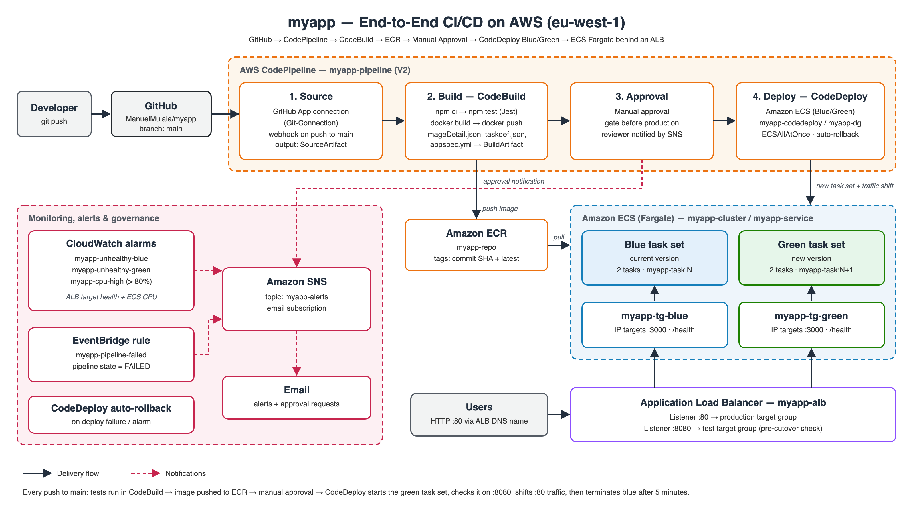

## Repository structure

```
myapp/
├── src/
│   ├── app.js              # Express app: GET / and GET /health (exported for tests)
│   ├── server.js           # Entry point: starts the app on port 3000
│   ├── package.json        # Dependencies and npm scripts (start, test)
│   └── package-lock.json
├── tests/
│   └── app.test.js         # Jest + Supertest tests for / and /health
├── Dockerfile              # node:20-alpine image, production deps only
├── buildspec.yml           # CodeBuild: install, test, build, push, write artifacts
├── appspec.yml             # CodeDeploy: ECS service + container/port to shift traffic to
├── taskdef.json            # ECS task definition template (image = <IMAGE1_NAME>)
├── pipeline-diagram.png    # Architecture / pipeline flow
└── README.md
```

## Application

| Endpoint | Response |
|---|---|
| `GET /` | `Hello from AWS CI/CD Capstone Project V2!` |
| `GET /health` | `{"status":"ok"}` (used by the ALB target group health check) |

Run it locally:

```bash
cd src && npm ci && npm test && cd ..
docker build --platform linux/amd64 -t myapp .
docker run --rm -p 3000:3000 myapp     # http://localhost:3000
```

The tests use Supertest to call the real Express routes, so a broken route fails the build.

## Pipeline stages

| # | Stage | Service | What happens |
|---|---|---|---|
| 1 | Source | CodePipeline + GitHub App connection | A webhook starts the pipeline on every push to `main` |
| 2 | Build | CodeBuild `myapp-build` | `npm ci` → `npm test` → `docker build` → push to ECR `myapp-repo` (tagged with the commit SHA and `latest`). Outputs `imageDetail.json`, `taskdef.json` and `appspec.yml` |
| 3 | Approval | Manual approval | The pipeline pauses and SNS emails the reviewer, who approves or rejects in the console |
| 4 | Deploy | CodeDeploy `myapp-codedeploy` / `myapp-dg` | Registers a new task definition revision and runs an ECS blue/green deployment |

Approval comes **before** Deploy so nothing reaches production without sign-off. If the tests fail, the build stops in `pre_build`, so no image is pushed and nothing is deployed.

### Build artifacts

- `imageDetail.json`: the new image URI. The deploy action substitutes it for `<IMAGE1_NAME>` in `taskdef.json`.
- `taskdef.json`: the task definition template. CodeDeploy registers it as a new revision.
- `appspec.yml`: tells CodeDeploy which container and port (`myapp-container:3000`) to route traffic to. `<TASK_DEFINITION>` is filled in by the pipeline.
- `imagedefinitions.json`: also produced, for the standard (rolling) ECS deploy action.

## Infrastructure

| Component | Name / setting |
|---|---|
| ECR repository | `myapp-repo` (scan on push) |
| ECS cluster | `myapp-cluster` (Fargate, Container Insights on) |
| ECS service | `myapp-service`, 2 tasks, deployment controller `CODE_DEPLOY` |
| Task definition | `myapp-task`: 0.25 vCPU / 512 MB, logs to `/ecs/myapp` |
| Load balancer | `myapp-alb`, internet-facing, 3 AZs |
| Listeners | `:80` production, `:8080` test |
| Target groups | `myapp-tg-blue`, `myapp-tg-green` (IP type, port 3000, health check `/health`) |
| Security groups | `alb-sg` (in 80/8080 from internet, out 3000 to tasks); `ecs-tasks-sg` (in 3000 from `alb-sg` only) |
| IAM roles | `ecsTaskExecutionRole`, `CodeDeployECSRole`, CodeBuild and CodePipeline service roles |

## How the blue/green deployment works

1. CodeDeploy starts a **replacement (green) task set** with the new image. It registers that task set in the idle target group.
2. The test listener on **:8080** routes to the new tasks, so you can check them before the cutover.
3. Once the health checks pass, the production listener on **:80** switches all traffic to the new target group (`CodeDeployDefault.ECSAllAtOnce`).
4. The original task set keeps running for **5 minutes** in case you need to roll back, then it is terminated.
5. The next release goes the opposite way, because blue and green swap roles on each deploy.

**Auto-rollback:** CodeDeploy rolls back automatically if the deployment fails, or if an unhealthy-host alarm fires during the deployment.

## Monitoring and alerts

| Item | Trigger | Action |
|---|---|---|
| `myapp-unhealthy-blue` alarm | `UnHealthyHostCount` > 0 for 2 minutes on `myapp-tg-blue` | Email via SNS, CodeDeploy rollback |
| `myapp-unhealthy-green` alarm | `UnHealthyHostCount` > 0 for 2 minutes on `myapp-tg-green` | Email via SNS, CodeDeploy rollback |
| `myapp-cpu-high` alarm | ECS service CPU > 80% for 3 minutes | Email via SNS |
| EventBridge rule `myapp-pipeline-failed` | Pipeline execution state = `FAILED` | Email via SNS |
| Manual approval | Pipeline reaches the Approval stage | Email via SNS |

All notifications go to the SNS topic **`myapp-alerts`**, which has an email subscription.

## Testing performed

| Test | Result |
|---|---|
| First deployment (commit `83b5339`) | Build passed, image pushed to ECR, blue/green deployment succeeded |
| v2 release (commit `fb50b8e`) | Approval email received and approved, blue/green deployment `d-APOZP3P5M` succeeded, live site shows "V2" |
| Failing test (commit `eb19653`) | Build failed in `PRE_BUILD` (`1 failed, 1 passed`), no image pushed, FAILED email received |
| Revert (commit `ac5249c`) | Pipeline green again |

## Screenshots

### Successful release

| | |
|---|---|
| Pipeline: all stages green | 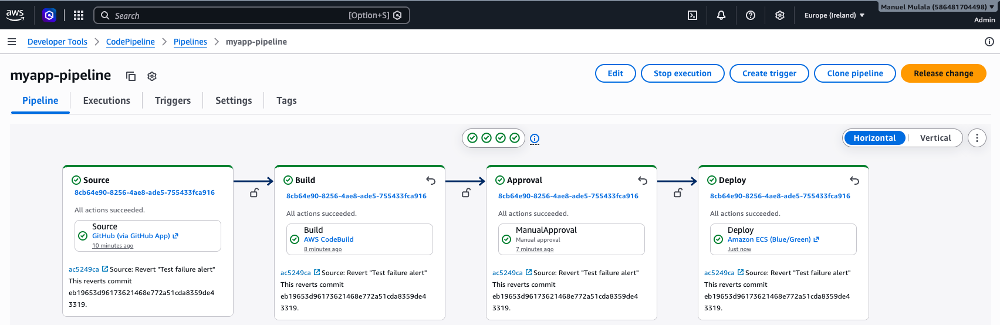 |
| Manual approval decision | 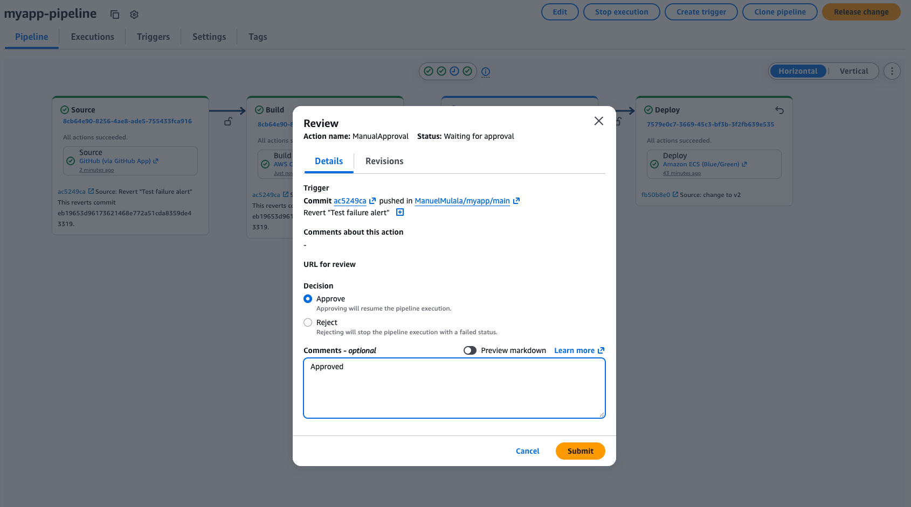 |
| Manual approval review summary (Approved) | 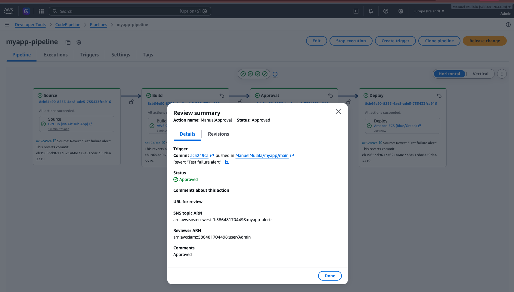 |
| Approval request email (SNS) | 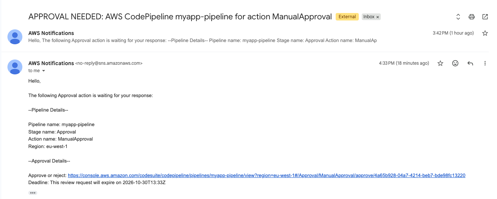 |
| CodeDeploy blue/green traffic shift | 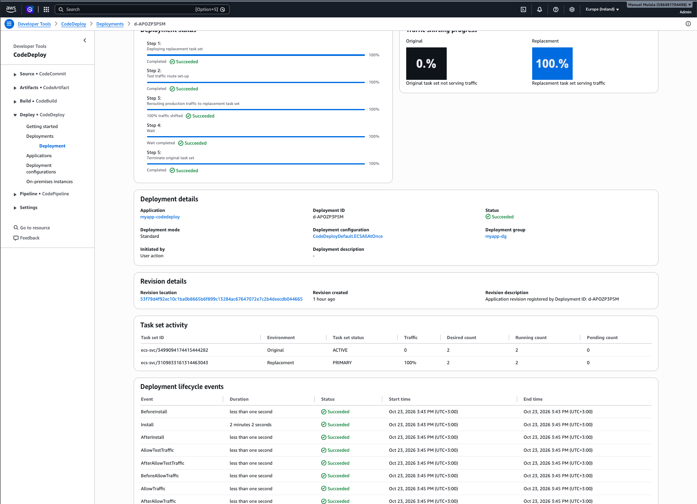 |
| CodeDeploy alarms and rollback settings | 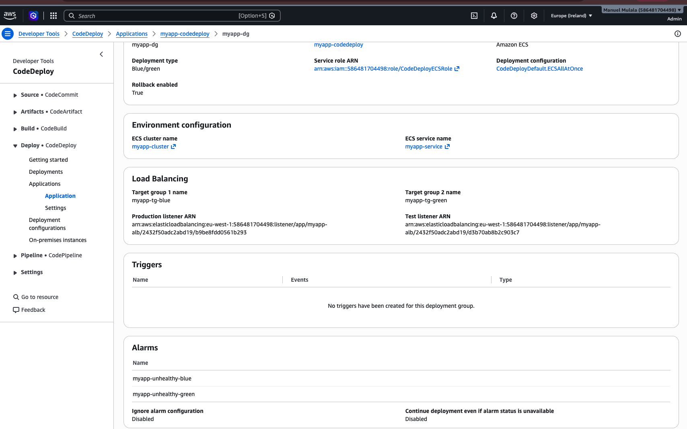 |
| ECR images tagged by commit | 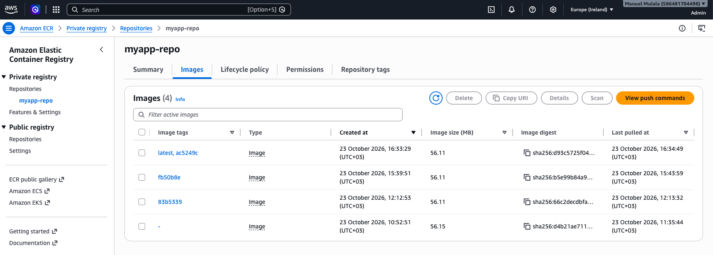 |
| ECS service with 2 running tasks | 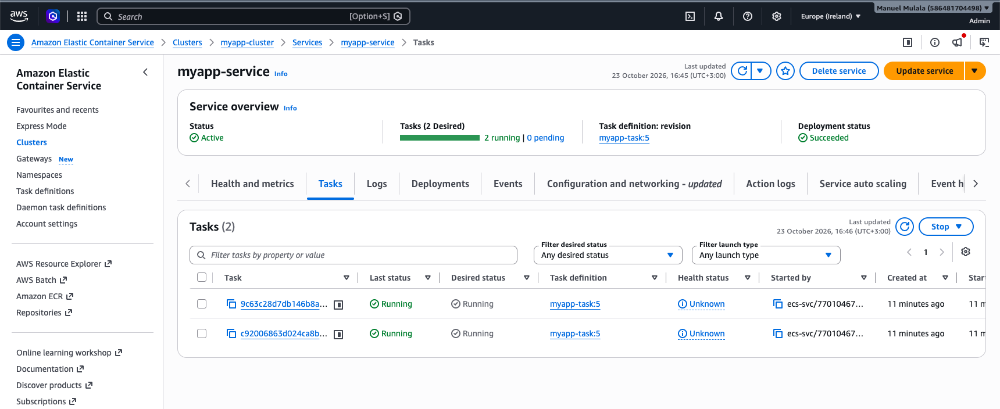 |
| Target group: 2 healthy targets | 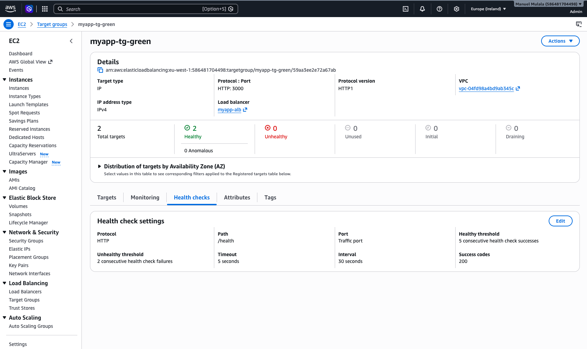 |
| Live app (V2) in browser | 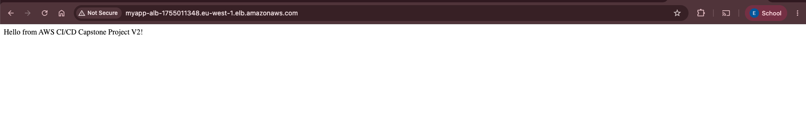 |

### Monitoring

| | |
|---|---|
| CloudWatch alarms | 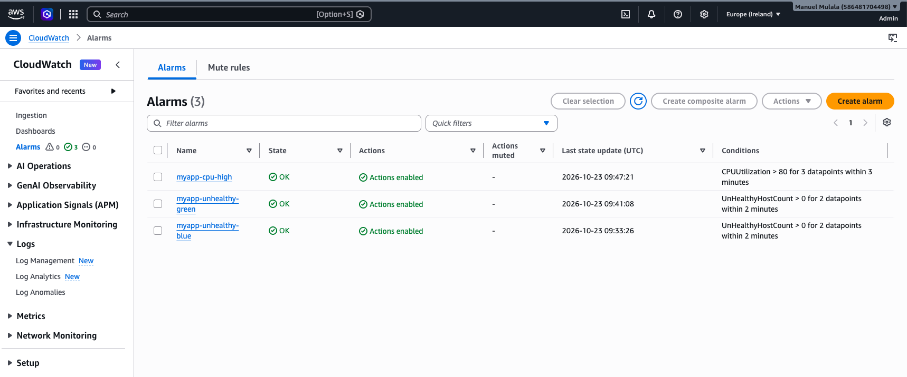 |
| EventBridge rule for pipeline failures | 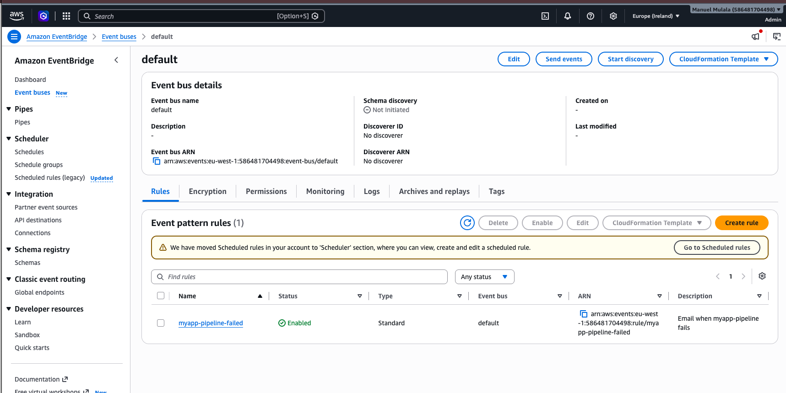 |

### Failure test (broken unit test)

| | |
|---|---|
| Pipeline stopped at Build | 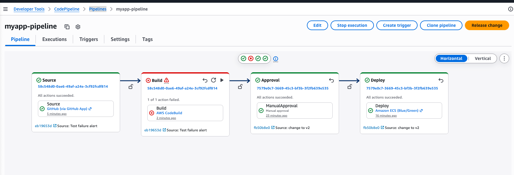 |
| Build phase details: PRE_BUILD failed | 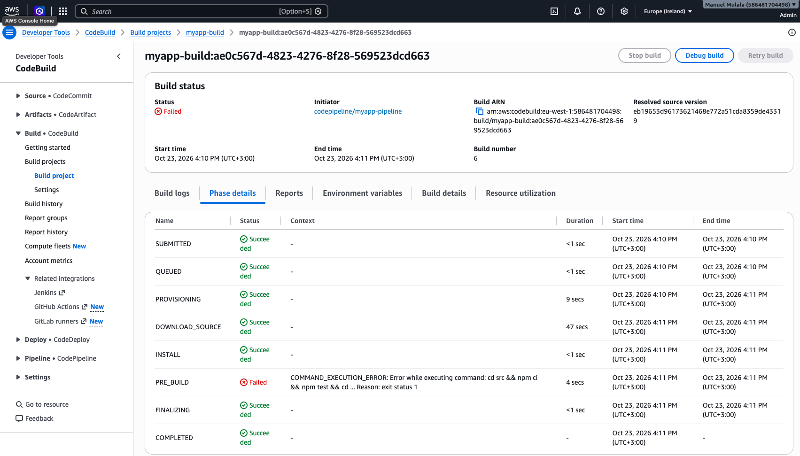 |
| Build log: failing Jest test | 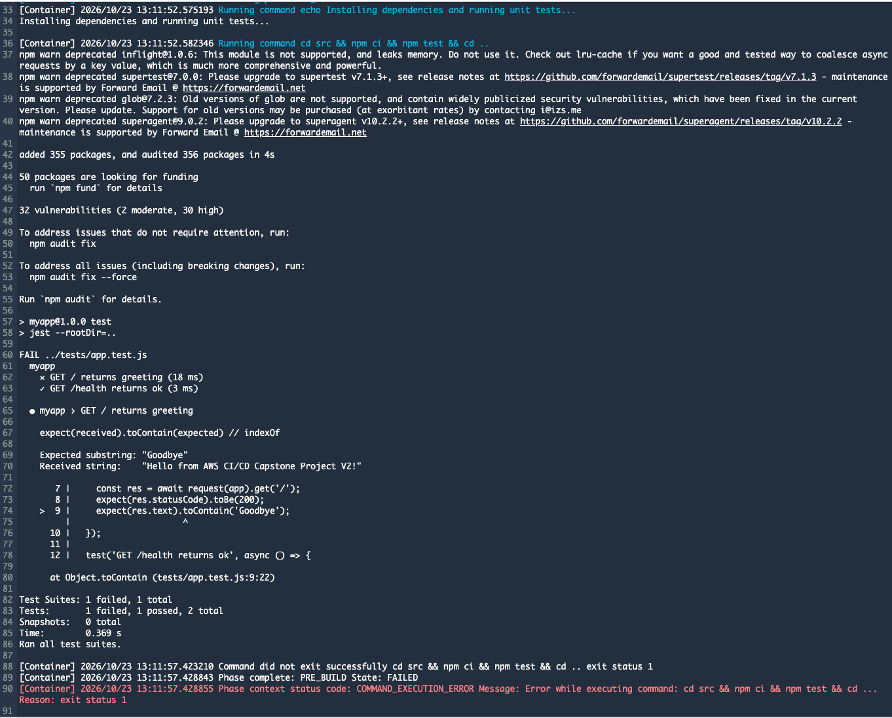 |
| FAILED notification email | 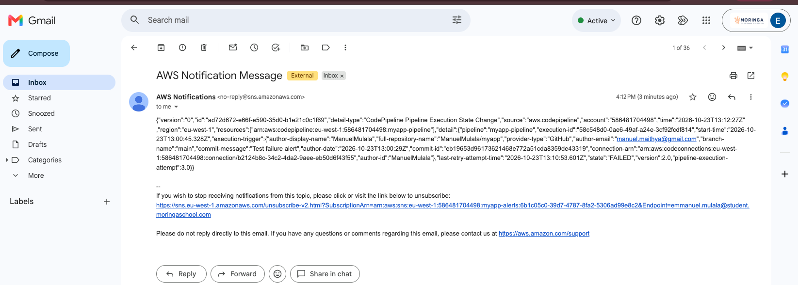 |

## Issues met and fixes

| Problem | Cause | Fix |
|---|---|---|
| ALB returned 503 and targets showed `Target.Timeout` | `alb-sg` outbound rules only allowed port 80 | Added outbound TCP 3000 from `alb-sg` to `ecs-tasks-sg` |
| One target showed `Target.NotInUse` | A task ran in eu-west-1c, but the ALB only covered 1a and 1b | Added the 1c subnet to the ALB |
| Approval stage failed with `PermissionError` | The pipeline role had no `sns:Publish` permission | Added an inline policy allowing `sns:Publish` on `myapp-alerts` |
| No email on pipeline failure | The SNS topic policy didn't allow EventBridge to publish | Added a statement for `events.amazonaws.com`, scoped to the rule ARN |
| Image built on an Apple Silicon Mac wouldn't run on Fargate | The local build produced an arm64 image | Build with `--platform linux/amd64` (CodeBuild builds amd64 natively) |
| `aws ecs wait services-stable` errored | That waiter doesn't support CodeDeploy-controlled services | Check target health or the CodeDeploy console instead |

## Teardown

To avoid charges (the ALB and Fargate tasks are billed hourly), delete these in this order:

1. The CodePipeline `myapp-pipeline`, then the CodeBuild project `myapp-build`
2. The CodeDeploy application `myapp-codedeploy`
3. The ECS service `myapp-service` (force delete), then the cluster `myapp-cluster`
4. The ALB `myapp-alb`, then both target groups
5. The ECR repository `myapp-repo` (including its images)
6. The CodePipeline artifact S3 bucket (empty it, then delete it)
7. The CloudWatch alarms, the EventBridge rule, the SNS topic and the log groups `/ecs/myapp` and `/aws/codebuild/myapp-build`
